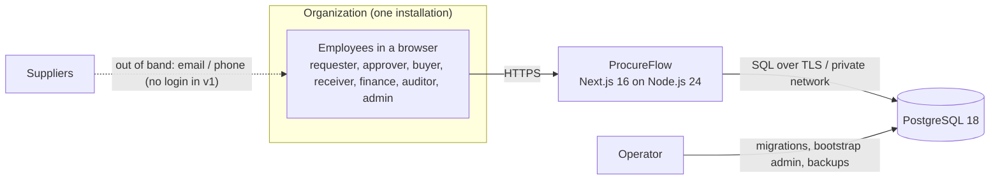
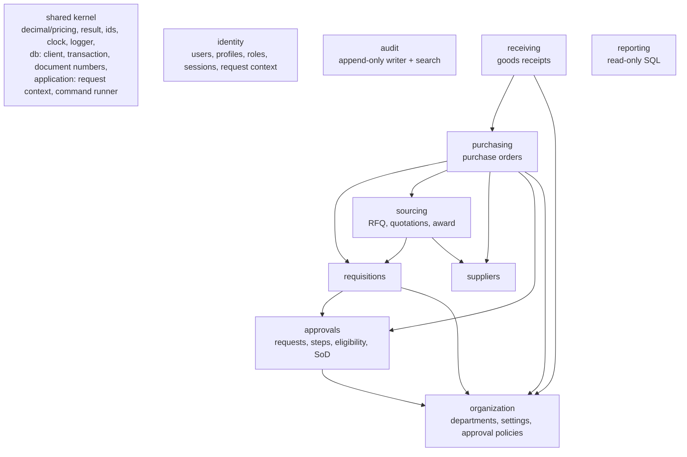
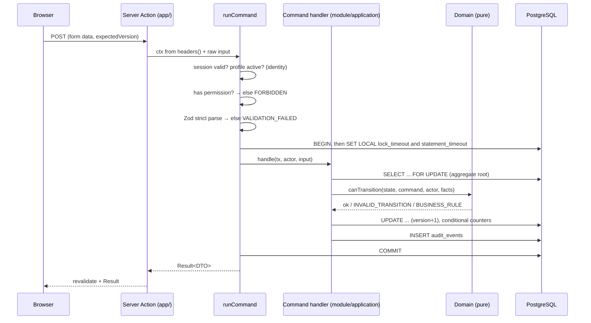

# Architecture overview

This page connects the decision records. The details live in the ADRs (`docs/adr/`), the schema (`schema.md`), the state machines (`state-machines.md`), the contracts (`api-contracts.md`), and the threat model (`threat-model.md`).

## System context

## Modules and allowed dependencies

Rules:

- Arrows point from the importing module to the module it may import, and only through that module's `index.ts`. Cycles are forbidden.
- Every module may also import `shared`, `identity` (actor and request-context types, permission checks), and `audit` (the writer). Those edges are left out of the diagram to keep it readable. `audit` imports only `shared`. `identity` imports `shared` and `audit`, because provisioning users and granting roles must be audited (changed in Phase 3a). Neither imports any other module, so there is no cycle.
- `health` (operational readiness for `GET /api/health`, added in Phase 1) imports only `shared`. It is public by design and returns only up/down status.
- The graph is encoded once, as `MODULE_DEPENDENCIES` in `eslint.config.mjs`. Change that and this diagram together.
- `src/server/` is the composition root. `src/server/schema.ts` re-exports every module's tables for drizzle-kit.
- **Approvals never imports requisitions or purchasing.** When a request completes, approvals calls an `ApprovalOutcomeHandler` port registered by each document module in the composition root (`src/server/`). The callback runs inside the same transaction.
- **Reporting** reads through SQL views defined in migrations (one per report). It never writes and never imports other modules' internals. This is the one documented exception to "each module owns its tables": the views are its contract.
- The ESLint `no-restricted-imports` config encodes this graph. Phase 1 adds a test that a forbidden import fails lint.

## Request lifecycle (mutation)

Reads follow the same path without a write transaction: session → permission → validated params → scoped SQL → DTO.

## Cross-cutting concerns

| Concern | Approach |
| --- | --- |
| Configuration | `src/shared/env.ts` validates `process.env` with Zod at startup. Only server code reads it. No `NEXT_PUBLIC_` secrets. |
| Logging | Structured JSON to stdout (`level`, `msg`, `requestId`, `userId`, `command`, `durationMs`, `errorCode`), redaction allowlist, no request bodies |
| Request id | Generated in `proxy.ts` (or accepted from a trusted proxy header). Propagated to logs and audit. |
| Time | DB `now()` for audit and business timestamps. Business dates in the org timezone through a single `clock` helper, injectable in tests. |
| Errors | `Result` envelope (ADR 0010). Unknown errors become `INTERNAL` with a generic message. |
| i18n | English UI for v1. All user-facing strings live in per-module message files so translation can be added without touching logic. |
| Accessibility | Semantic HTML forms that work without JavaScript (Server Actions). Labels and errors tied to fields. Keyboard reachable. Checked with Playwright + axe in E2E (from Phase 3). |
| Caching | Business pages render dynamically per request. No shared caches of user-scoped data. `revalidatePath` / `updateTag` after mutations. |

## Deployment view (target, documented in Phase 10)

- `next build` with `output: 'standalone'`, run with `node server.js` under a process manager or container, behind a TLS reverse proxy.
- Environment: `DATABASE_URL` (app role), `DATABASE_MIGRATION_URL` (owner role, used only by the migration job), `BETTER_AUTH_SECRET`, `BETTER_AUTH_URL`, and `NEXT_SERVER_ACTIONS_ENCRYPTION_KEY` (required with more than one instance).
- Release order: back up the database, run migrations as the owner, start the new app version, smoke-test `/api/health` (checks DB connectivity and migration level).
- Horizontal scaling is safe: no in-memory state is shared between requests (rate limits and sessions live in PostgreSQL).
