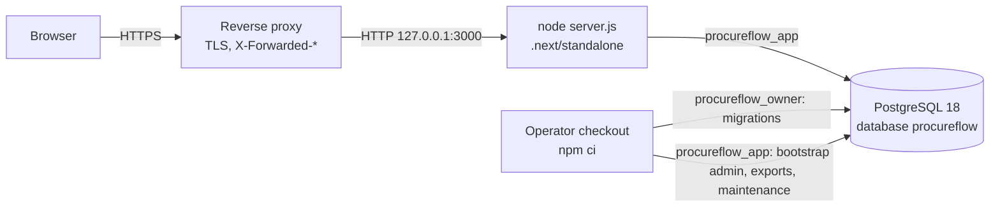

# Deploying ProcureFlow

This guide installs one ProcureFlow instance from a release tag: a PostgreSQL 18 database with two roles, one Node.js process serving the app, and a reverse proxy in front of it for HTTPS. Day-to-day operations (backups, audit archives, maintenance, incidents) are in [operations.md](operations.md). Local development is in [development.md](development.md).

Steps 1 to 7 were followed literally on 2026-10-30 for the v0.1.0 release candidate, in a fresh clone (no `.env`, no `node_modules`) against a new, empty PostgreSQL 18 cluster, in Windows PowerShell, with the server on port 3200 ([reports/phase-10.md](reports/phase-10.md)). The clone was the previous commit plus the release changes, because the tag did not exist yet. The reverse-proxy step (8) and the systemd unit were not run.

## What you get



- **The server** is the standalone build in `.next/standalone`: `server.js` with only the dependencies it needs. It reads all configuration from environment variables at start; the build contains no `.env` file (`npm run build` removes any that Next.js copied).
- **The operator checkout** is a clone of the same tag with `npm ci`. It builds the server and runs the migration job, the first-admin script, and the maintenance commands. It needs the development dependencies; the server does not.
- **Two database roles (ADR 0013).** `procureflow_owner` owns the schema and runs migrations. `procureflow_app` is the only role the server uses: it reads and writes business tables, cannot change the schema, and can only insert and read audit events.

## Requirements

- Node.js 24 (`.nvmrc`) on the operator machine and the server. npm comes with it.
- PostgreSQL 18, with a role allowed to `CREATE ROLE` and `CREATE DATABASE` (the superuser of a new cluster is fine) and the client tools `psql`, `pg_dump`, `pg_restore`.
- Git, to get the release.
- For a real installation: a domain name, a TLS certificate, and a reverse proxy (step 8).

Commands below are written for a POSIX shell. In Windows PowerShell, set a variable with `$env:NAME = 'value'` instead of `export NAME=value`, and read it with `$env:NAME` instead of `$NAME`.

## 1. Get the release

```bash
git clone <repository URL> procureflow
cd procureflow
git checkout v0.1.0
npm ci
```

`npm ci` installs exactly the locked versions and runs no install scripts (`.npmrc`, ADR 0012).

## 2. Generate the secrets

Generate each value once per installation and keep it in your secret store, never in the repository:

```bash
node -e "console.log(require('node:crypto').randomBytes(24).toString('hex'))"     # OWNER_DB_PASSWORD
node -e "console.log(require('node:crypto').randomBytes(24).toString('hex'))"     # APP_DB_PASSWORD
node -e "console.log(require('node:crypto').randomBytes(48).toString('base64url'))"  # BETTER_AUTH_SECRET
node -e "console.log(require('node:crypto').randomBytes(32).toString('base64'))"  # NEXT_SERVER_ACTIONS_ENCRYPTION_KEY
```

Hex passwords need no escaping inside connection URLs. `BETTER_AUTH_SECRET` signs session cookies and setup links: at least 32 characters (the server refuses to start otherwise), different in every environment. `NEXT_SERVER_ACTIONS_ENCRYPTION_KEY` encrypts Server Action ids; it must be the same on every instance and across rebuilds (see "Several instances").

## 3. Create the database and the roles

As the PostgreSQL superuser (`DATABASE_ADMIN_URL`, e.g. `postgres://postgres:<password>@db.internal:5432/postgres`):

```bash
export DATABASE_ADMIN_URL='postgres://postgres:<password>@<host>:5432/postgres'
psql "$DATABASE_ADMIN_URL" -v ON_ERROR_STOP=1 \
  -c "CREATE ROLE procureflow_owner LOGIN PASSWORD '<OWNER_DB_PASSWORD>'" \
  -c "CREATE DATABASE procureflow OWNER procureflow_owner"
export APP_DB_PASSWORD='<APP_DB_PASSWORD>'
npm run db:app-role
```

`db:app-role` creates `procureflow_app` with `LOGIN` and nothing else (no superuser, no `CREATEDB`, no `CREATEROLE`, no `BYPASSRLS`); running it again sets the password again. The owner role needs no special attributes either. Table privileges come from the migrations.

## 4. Run the migrations

The migration job runs as the owner, from the operator checkout, before the server starts (and before every upgrade):

```bash
export DATABASE_MIGRATION_URL='postgres://procureflow_owner:<OWNER_DB_PASSWORD>@<host>:5432/procureflow'
npm run db:migrate
```

It prints `Migrations applied.` Migrations are append-only and run in order; the first one stops with a clear message if `procureflow_app` does not exist yet.

## 5. Build the server

```bash
export NEXT_TELEMETRY_DISABLED=1
export NEXT_SERVER_ACTIONS_ENCRYPTION_KEY='<NEXT_SERVER_ACTIONS_ENCRYPTION_KEY>'
npm run build
```

The build needs no database and no other secret. It ends with `Standalone server ready: node .next/standalone/server.js`. **Treat `.next/` as confidential:** it holds per-build keys (preview mode, Server Action encryption) even without a `.env` file. Copy `.next/standalone` (it already contains `.next/static`) to the server, for example to `/opt/procureflow`.

## 6. Configure and start the server

The server needs these variables (`.env.example` lists them too):

| Variable | Value |
| --- | --- |
| `NODE_ENV` | `production` |
| `DATABASE_URL` | `postgres://procureflow_app:<APP_DB_PASSWORD>@<host>:5432/procureflow` (the runtime role, never the owner) |
| `BETTER_AUTH_SECRET` | from step 2 |
| `BETTER_AUTH_URL` | the public origin, e.g. `https://procurement.example.com`; with `https` the session cookies are `Secure` and `__Secure-`; it is also the only trusted origin |
| `HOSTNAME`, `PORT` | where the server listens; behind a proxy on the same machine `127.0.0.1` and `3000` |
| `NEXT_SERVER_ACTIONS_ENCRYPTION_KEY` | the same value as at build time |
| `TRUSTED_PROXIES` | the reverse proxies' addresses, comma-separated IPs or CIDR ranges, e.g. `127.0.0.1` (step 8) |
| `LOG_LEVEL` | optional: `debug`, `info` (default), `warn`, `error`; logs are JSON lines on stdout |
| `NEXT_TELEMETRY_DISABLED` | `1` to opt out of Next.js telemetry |

```bash
cd /opt/procureflow
NODE_ENV=production DATABASE_URL='…' BETTER_AUTH_SECRET='…' BETTER_AUTH_URL='https://procurement.example.com' \
  HOSTNAME=127.0.0.1 PORT=3000 NEXT_SERVER_ACTIONS_ENCRYPTION_KEY='…' node server.js
```

With a missing or invalid variable the server prints which one (never its value) and exits with code 1. Run it under a service manager that restarts it and keeps the variables out of the process list, for example a systemd unit with `EnvironmentFile=/etc/procureflow/env` (mode 0600, owned by root):

```ini
[Unit]
Description=ProcureFlow
After=network-online.target

[Service]
WorkingDirectory=/opt/procureflow
EnvironmentFile=/etc/procureflow/env
ExecStart=/usr/bin/node server.js
User=procureflow
Restart=on-failure
NoNewPrivileges=true
ProtectSystem=strict
ProtectHome=true
PrivateTmp=true

[Install]
WantedBy=multi-user.target
```

## 7. Health check and first administrator

```bash
curl -s http://127.0.0.1:3000/api/health
```

answers `{"status":"ok","checks":{"database":"ok"}}` with HTTP 200, or `503` with `"unavailable"` when the database cannot be reached. It is public by design and says nothing else; point the load balancer or monitor at it.

Then create the first administrator from the operator checkout, with the server's `DATABASE_URL`, `BETTER_AUTH_SECRET`, and `BETTER_AUTH_URL` set:

```bash
npm run bootstrap-admin -- --email you@example.com --name "Your Name"
```

It prints a one-time link (valid 24 hours, single use) to set the password. Open it, set a password of at least 12 characters, and sign in. The script refuses to run once an active admin exists; further users, roles, departments, settings, and approval policies are managed in the app (**Admin**). Do not run `npm run seed` on a real installation: it creates fictional demo users (it refuses `NODE_ENV=production`).

## 8. Reverse proxy and HTTPS

Terminate TLS at a reverse proxy and forward to `127.0.0.1:3000`. The proxy must:

- send `X-Forwarded-For` and `X-Forwarded-Proto: https` (the app then sends `Strict-Transport-Security` and `upgrade-insecure-requests`);
- be the only way to reach the server (bind it to `127.0.0.1` or a private network), and be listed in `TRUSTED_PROXIES`.

The client IP limits sign-in attempts (5 per minute per client) and is recorded in the audit trail. With `TRUSTED_PROXIES` set, the app reads `X-Forwarded-For` from the right, skips the listed proxies, and takes the first address that is not one, so whatever a client writes into the header itself is ignored; this also works through several proxies (a CDN, then a load balancer). Without it, the app trusts the header only when it holds exactly one address. If no client address can be found, every sign-in shares one limit, so a few wrong passwords from anyone lock everyone out for a minute: set `TRUSTED_PROXIES`.
- keep the `Host` header the one in `BETTER_AUTH_URL`.

Caddy (obtains a certificate itself):

```
procurement.example.com {
  reverse_proxy 127.0.0.1:3000
}
```

nginx:

```nginx
server {
  listen 443 ssl;
  server_name procurement.example.com;
  ssl_certificate     /etc/ssl/procurement.crt;
  ssl_certificate_key /etc/ssl/procurement.key;
  client_max_body_size 2m;
  location / {
    proxy_pass http://127.0.0.1:3000;
    proxy_set_header Host $host;
    proxy_set_header X-Forwarded-For $proxy_add_x_forwarded_for;
    proxy_set_header X-Forwarded-Proto https;
  }
}
```

The app sets its own security headers (CSP with a nonce, `X-Content-Type-Options`, `Referrer-Policy`, `Permissions-Policy`, `frame-ancestors 'none'`); the proxy does not need to add them.

## Several instances

ProcureFlow keeps no state in the process: sessions, sign-in rate limits, and idempotency keys are in PostgreSQL. To run more than one instance behind a load balancer:

- deploy the **same build** to every instance, built with the same `NEXT_SERVER_ACTIONS_ENCRYPTION_KEY` (a form loaded from one instance must post to another, also across a rolling upgrade);
- give every instance the same `BETTER_AUTH_SECRET`, `BETTER_AUTH_URL`, and `DATABASE_URL`;
- run the migration job once, before the new build starts serving;
- size the database connections: each instance opens up to 10.

## Upgrading

1. Read the release notes in `CHANGELOG.md`.
2. Back up the database ([operations.md](operations.md#backup)).
3. In the operator checkout: `git fetch --tags`, `git checkout <new tag>`, `npm ci`.
4. Run the migrations (step 4), then build (step 5) and replace `/opt/procureflow` with the new `.next/standalone`; restart the service.
5. Check `/api/health` and sign in.

Migrations only add; to go back a version, restore the backup taken in step 2.
