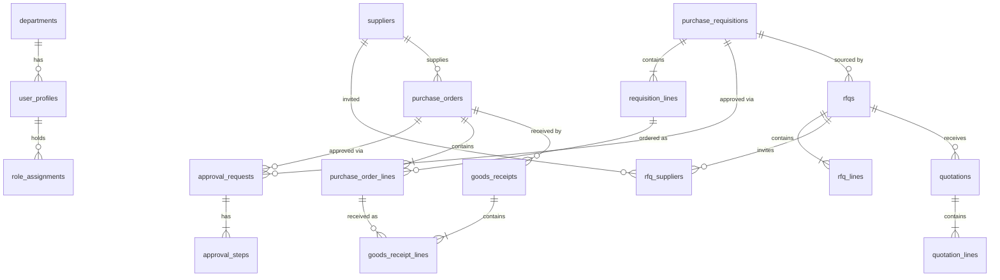

# Database schema (v1 design)

PostgreSQL 18. This is the **design**. The source of truth after Phase 2 is the Drizzle schema in `src/modules/*/infrastructure/` and the reviewed SQL in `db/migrations/`. If they drift, the migrations win and this document gets updated in the same change.

## Conventions

- **Primary keys:** `id uuid DEFAULT uuidv7()` (time-ordered; PostgreSQL 18 built-in, confirmed in Phase 1). Exceptions: Better Auth tables (text ids), `audit_events` (`bigint` identity), and composite-key join tables.
- **User references** point to Better Auth's `"user".id` (`text`) and are named `*_user_id`.
- **Timestamps:** `timestamptz`, `created_at DEFAULT now()`, `updated_at` set by the application. Business dates (`needed_by`, `received_on`) are `date` in the org timezone.
- **Status columns** are `text` with a `CHECK (status IN (...))`, not PostgreSQL enums, so states can evolve with plain migrations.
- **Mutable aggregate roots** carry `version integer NOT NULL DEFAULT 1` (ADR 0008 C1).
- **Money** `numeric(20,4)`, **quantities** `numeric(18,3)`, **percentages** `numeric(7,4)` (ADR 0007).
- **No hard deletes** of business documents. Drafts are cancelled, not deleted. Only draft lines can be removed (and that is audited).
- **Text limits** are enforced in Zod and backed by `CHECK (char_length(x) <= n)` on key columns.
- **Roles:** `procureflow_owner` owns everything. `procureflow_app` gets `SELECT, INSERT, UPDATE` on business tables, **no `DELETE`** except on draft line tables and `idempotency_keys`, and `INSERT, SELECT` only on `audit_events`. Roles are created by bootstrap, not migrations. Each migration grants per table, explicitly (ADR 0013).

---

## Identity (implemented in Phases 3a and 3b)

**Better Auth tables** (`users`, `sessions`, `accounts`, `verifications`, `rate_limits`) were generated by the Better Auth 1.7.7 CLI, then reviewed. They live in `src/modules/identity/infrastructure/auth-schema.ts`, with migrations `0003` and `0004`.
- Ids are `uuid DEFAULT gen_random_uuid()` (`generateId: uuid`), so every `*_user_id` below is `uuid`, not `text`.
- Timestamps are `timestamptz`.
- `users.email` is unique and lowercase (CHECK), and `users.name` (1 to 120 chars) is the display name. There is no separate `display_name`.
- `accounts.password` holds the scrypt hash. Sessions and accounts reference users with `ON DELETE CASCADE` as generated, but the runtime role has **no DELETE on users**, so that never fires through the app.

### `user_profiles`

| Column | Type | Constraints |
| --- | --- | --- |
| user_id | uuid | PK, FK → `users.id` (RESTRICT) |
| department_id | uuid | FK → departments, NULL allowed (e.g. auditor) |
| status | text | `CHECK IN ('active','deactivated')`, default `active` |
| deactivated_at / deactivated_by_user_id | timestamptz / uuid | set exactly when status is `deactivated` (CHECK). `CHECK (deactivated_by_user_id <> user_id)`: nobody deactivates themselves (SOD-05 backstop, migration 0005). |
| created_at, updated_at, version | | `version` is bumped by every profile or status change (ADR 0008 C1). |

### `role_assignments`

| Column | Type | Constraints |
| --- | --- | --- |
| id | uuid | PK, `uuidv7()` |
| user_id | uuid | FK → users, NOT NULL |
| role | text | `CHECK IN ('admin','requester','approver','procurement','receiver','finance','auditor')` (`buyer` renamed `procurement`, ADR 0014) |
| department_id | uuid | NULL means org-wide. `CHECK`: only `requester` and `approver` may be department-scoped. |
| granted_by, granted_at | text, timestamptz | a user id, or `system:bootstrap` / `system:seed`. `CHECK (granted_by <> user_id::text)` is the SOD-05 backstop. |
| revoked_by, revoked_at, revoke_reason | text, timestamptz, text | `revoked_at` and `revoked_by` both NULL or both set. Self-revocation is blocked by CHECK. `revoke_reason` ≤ 500 chars. |

Index `role_assignments_active_unique`: `UNIQUE (user_id, role, coalesce(department_id, nil-uuid)) WHERE revoked_at IS NULL`. Revocation is an update, never a delete, so assignment history is kept.

Trigger `role_assignments_revocation_only` (migration 0005, `BEFORE UPDATE`): the only allowed change is a one-time revocation (`revoked_at`, `revoked_by`, `revoke_reason` on a row not yet revoked). Changing `user_id`, `role`, `department_id`, or `granted_*`, or touching a revoked row, raises SQLSTATE `PFR01`, for every role including the owner.

**Runtime grants (migration 0004):** SELECT/INSERT/UPDATE on `users`, `accounts`, `departments`, `user_profiles`, `role_assignments`. DELETE as well only on `sessions`, `verifications`, `rate_limits`. Deactivation uses the DELETE grants to revoke the user's sessions and unused setup links (`verifications` rows `reset-password:*` whose value is the user id) in the same transaction.

**Admin-set lock:** commands that change users or roles take `pg_advisory_xact_lock(0x50460001)` first (ADR 0008 C9). It is not a table, but it is part of how the identity data stays consistent.

## Organization

### `departments` (implemented in Phase 3a)
`id uuid DEFAULT uuidv7()`, `code text UNIQUE CHECK (code ~ '^[A-Z0-9-]{2,16}$')`, `name` (1 to 120 chars), `is_active boolean DEFAULT true`, timestamps, `version`.

### `org_settings` (single row)

*Not built yet (maintainer decision, 2026-10-22).* Each column arrives with the phase whose behavior it controls, so no setting exists before it has an effect: org name, timezone, and currency in Phase 5; `rfq_required_above` and `min_quotes` in Phase 6; `po_approval_threshold` and `po_price_tolerance_pct` in Phase 7; `over_receipt_tolerance_pct` in Phase 8.

| Column | Type | Notes |
| --- | --- | --- |
| id | smallint | PK, `CHECK (id = 1)` |
| org_name | text | |
| timezone | text | IANA name, validated in the app (e.g. `UTC`, `America/New_York`) |
| currency_code | char(3) | ISO 4217 |
| currency_scale | smallint | `CHECK BETWEEN 0 AND 4` |
| rfq_required_above | numeric(20,4) | NULL means RFQs are never required |
| min_quotes | smallint | `CHECK >= 1`, default 3 |
| po_approval_threshold | numeric(20,4) | NULL means every PO needs approval |
| po_price_tolerance_pct | numeric(7,4) | default 0 |
| over_receipt_tolerance_pct | numeric(7,4) | default 0 |
| updated_at, updated_by_user_id, version | | |

### `approval_policies`, `approval_policy_rules`, `approval_policy_steps`

Policies are **immutable once created**. "Editing" means creating a new policy and activating it, and the old one gets `superseded_at`.

- `approval_policies`: `id`, `document_type CHECK IN ('requisition','purchase_order')`, `name`, `is_active boolean`, `created_by_user_id`, `created_at`, `superseded_at`. Index: `UNIQUE (document_type) WHERE is_active`.
- `approval_policy_rules`: `id`, `policy_id FK`, `department_id` (NULL means any department), `min_amount numeric(20,4) NOT NULL DEFAULT 0`, `max_amount numeric(20,4)` (exclusive, NULL means unbounded), `CHECK (max_amount IS NULL OR max_amount > min_amount)`. When a policy is saved, the application rejects overlapping bands for the same department, and requires full coverage from 0 upward for the "any department" rules.
- `approval_policy_steps`: `rule_id FK`, `step_no smallint CHECK >= 1`, `required_role CHECK IN ('approver','finance')`, `scope_mode CHECK IN ('document_department','organization')`, `PK (rule_id, step_no)`.

Rule resolution: a department-specific rule beats an "any department" rule, then the amount band `[min, max)` is matched against the document total.

## Requisitions

### `purchase_requisitions`

| Column | Type | Constraints |
| --- | --- | --- |
| id | uuid | PK |
| number | text | UNIQUE, `PR-YYYY-NNNNNN` |
| requester_user_id | text | NOT NULL |
| department_id | uuid | NOT NULL, copied from the requester's profile at create |
| title | text | 1 to 200 chars |
| justification | text | ≤ 2000 chars |
| needed_by | date | |
| currency_code | char(3) | |
| estimated_total | numeric(20,4) | `CHECK >= 0`, server-computed |
| status | text | `CHECK IN ('draft','pending_approval','returned','approved','rejected','cancelled','closed')` |
| current_approval_request_id | uuid | FK, NULL allowed |
| submitted_at, approved_at | timestamptz | |
| cancelled_at, cancelled_by_user_id, cancel_reason | | |
| closed_at, closed_by_user_id, close_reason | | |
| created_at, updated_at, version | | |

Indexes: `(requester_user_id, status)`, `(department_id, status)`, `(status, submitted_at)`.

### `requisition_lines`

| Column | Type | Constraints |
| --- | --- | --- |
| id | uuid | PK |
| requisition_id | uuid | FK, NOT NULL |
| line_no | smallint | `UNIQUE (requisition_id, line_no)` |
| description | text | 1 to 500 chars |
| quantity | numeric(18,3) | `CHECK > 0` |
| uom | text | 1 to 16 chars |
| estimated_unit_price | numeric(20,4) | `CHECK >= 0` |
| line_total | numeric(20,4) | server-computed |
| ordered_qty | numeric(18,3) | `DEFAULT 0`, `CHECK (ordered_qty >= 0 AND ordered_qty <= quantity)` (backstop for no over-ordering) |

## Approvals

### `approval_requests`

| Column | Type | Constraints |
| --- | --- | --- |
| id | uuid | PK |
| document_type | text | `CHECK IN ('requisition','purchase_order')` |
| document_id | uuid | |
| round | smallint | `UNIQUE (document_type, document_id, round)` |
| policy_id | uuid | FK |
| amount_snapshot | numeric(20,4) | |
| department_id | uuid | snapshot |
| submitted_by_user_id | text | NOT NULL (used by SOD-01) |
| awarded_by_user_id | text | NULL; for POs from an award (used by SOD-06) |
| status | text | `CHECK IN ('pending','approved','rejected','returned','cancelled')` |
| created_at, completed_at, version | | |

Index: `UNIQUE (document_type, document_id) WHERE status = 'pending'` (AP-I1).

### `approval_steps`

| Column | Type | Constraints |
| --- | --- | --- |
| id | uuid | PK |
| approval_request_id | uuid | FK |
| step_no | smallint | `UNIQUE (approval_request_id, step_no)` |
| required_role | text | |
| scope_department_id | uuid | NULL means org-wide |
| status | text | `CHECK IN ('waiting','pending','approved','rejected','returned','cancelled')` |
| decided_by_user_id, decided_at | text, timestamptz | `CHECK ((status IN ('approved','rejected','returned')) = (decided_by_user_id IS NOT NULL))` |
| comment | text | ≤ 2000. Required for rejected and returned (CHECK). |

Index: `UNIQUE (approval_request_id, decided_by_user_id)` (SOD-02; NULLs are distinct, so undecided steps don't collide).
Trigger `approval_steps_no_self_approval` (`BEFORE UPDATE`): raises if `NEW.decided_by_user_id` equals the parent request's `submitted_by_user_id` or `awarded_by_user_id` (SOD-01, SOD-06, defense in depth).

## Suppliers

### `suppliers` (implemented in Phase 4, migrations 0006 and 0007)

| Column | Type | Constraints |
| --- | --- | --- |
| id | uuid | PK, `uuidv7()` |
| code | text | UNIQUE, `CHECK ~ '^SUP-[0-9]{6}$'`, from the gapless `SUP` sequence (`document_sequences`, year 0) |
| legal_name | text | 1 to 200 chars |
| normalized_name | text | duplicate key: NFKC, lowercase, punctuation and whitespace runs → one space. `UNIQUE WHERE status <> 'inactive'`. |
| tax_id | text | as typed, ≤ 40 chars, NULL allowed |
| tax_id_normalized | text | duplicate key: `^[A-Z0-9]{5,30}$`. NULL exactly when `tax_id` is. `UNIQUE WHERE tax_id_normalized IS NOT NULL` (also against inactive suppliers). |
| email, phone | text | validated formats (email lowercased), ≤ 254 / ≤ 30 chars |
| address_line1, address_line2, city, region, postal_code | text | ≤ 200 / 200 / 100 / 100 / 20 chars |
| country_code | text | `^[A-Z]{2}$`; the app accepts only the 249 ISO 3166-1 alpha-2 codes |
| status | text | `CHECK IN ('pending_review','active','blocked','inactive')` |
| created_by_user_id | uuid | NOT NULL, FK → users (SOD-03). Fixed for life (trigger `PFS01`). |
| identity_changed_by_user_id | uuid | FK → users; last user who changed `legal_name` / `tax_id` (SOD-03) |
| reviewed_by_user_id, reviewed_at, review_note | uuid, timestamptz, text | set together (CHECK); cleared when the identity changes, on unblock, and on reactivation; note ≤ 2000 |
| status_reason | text | reason for reject / block / deactivate, ≤ 2000 |
| created_at, updated_at, version | | `version` per ADR 0008 C1 |

CHECKs beyond the column rules:
- `suppliers_maker_checker`: `reviewed_by_user_id` is NULL, or differs from `created_by_user_id` and from `identity_changed_by_user_id` (SOD-03 backstop).
- `suppliers_active_is_reviewed`: an `active` supplier always has a reviewer (AB-04 backstop).

Trigger `suppliers_fixed_identity_columns` (`BEFORE UPDATE`) rejects changes to `id`, `code`, `created_by_user_id`, and `created_at` with SQLSTATE `PFS01`. Index `suppliers_status_code_idx (status, code)` serves the list. Grants: `procureflow_app` gets SELECT, INSERT, UPDATE; no DELETE.

**Bank and payment details are intentionally not stored in v1.** Payments are out of scope, and keeping them out removes the classic bank-detail-change fraud vector from this system.

## Sourcing

- `rfqs`: `id`, `number UNIQUE` (`RFQ-YYYY-NNNNNN`), `requisition_id FK`, `title`, `status CHECK IN ('draft','issued','closed','awarded','cancelled')`, `response_due_at timestamptz`, `created_by_user_id`, `issued_at`, `closed_at`, `awarded_quotation_id FK NULL`, `awarded_by_user_id`, `awarded_at`, `award_justification text`, `cancel_reason`, timestamps, `version`.
- `rfq_lines`: `id`, `rfq_id FK`, `line_no`, `requisition_line_id FK`, `description`, `quantity numeric(18,3) CHECK > 0`, `uom`, `UNIQUE (rfq_id, line_no)`, `UNIQUE (rfq_id, requisition_line_id)`.
- `rfq_suppliers`: `rfq_id`, `supplier_id`, `invited_by_user_id`, `invited_at`, `PK (rfq_id, supplier_id)`.
- `quotations`: `id`, `rfq_id`, `supplier_id`, `FK (rfq_id, supplier_id) → rfq_suppliers` (only invited suppliers), `supplier_reference`, `status CHECK IN ('draft','submitted','withdrawn','awarded','not_awarded')`, `currency_code`, `valid_until date`, `lead_time_days CHECK >= 0`, `total numeric(20,4)`, `recorded_by_user_id`, `submitted_at`, `withdraw_reason`, timestamps, `version`. Index: `UNIQUE (rfq_id, supplier_id) WHERE status <> 'withdrawn'`.
- `quotation_lines`: `id`, `quotation_id FK`, `rfq_line_id FK`, `quantity`, `unit_price CHECK >= 0`, `line_total`, `UNIQUE (quotation_id, rfq_line_id)`.

## Purchasing

### `purchase_orders`

| Column | Type | Constraints |
| --- | --- | --- |
| id | uuid | PK |
| number | text | UNIQUE, `PO-YYYY-NNNNNN` |
| supplier_id | uuid | FK, NOT NULL |
| quotation_id | uuid | FK, NULL allowed |
| status | text | `CHECK IN ('draft','pending_approval','approved','issued','partially_received','received','closed','rejected','cancelled')` |
| currency_code | char(3) | |
| subtotal, tax_total, total | numeric(20,4) | server-computed, `CHECK >= 0` |
| payment_terms, delivery_address | text | |
| expected_delivery_date | date | |
| approval_reasons | text[] | e.g. `{AMOUNT_THRESHOLD, PRICE_VARIANCE}` computed at submit |
| current_approval_request_id | uuid | |
| created_by_user_id | text | NOT NULL (SOD-01, SOD-04) |
| submitted_at, approved_at, issued_at, issued_by_user_id | | |
| closed_at, closed_by_user_id, close_reason | | |
| cancelled_at, cancelled_by_user_id, cancel_reason | | |
| created_at, updated_at, version | | |

### `purchase_order_lines`

| Column | Type | Constraints |
| --- | --- | --- |
| id | uuid | PK |
| purchase_order_id | uuid | FK |
| line_no | smallint | `UNIQUE (purchase_order_id, line_no)` |
| requisition_line_id | uuid | FK, NOT NULL. Every PO line traces to an approved need. |
| quotation_line_id | uuid | FK, NULL allowed |
| description, uom | text | |
| quantity | numeric(18,3) | `CHECK > 0` |
| unit_price | numeric(20,4) | `CHECK >= 0` |
| tax_rate_pct | numeric(7,4) | `CHECK BETWEEN 0 AND 100` |
| line_subtotal, line_tax, line_total | numeric(20,4) | server-computed |
| received_qty | numeric(18,3) | `DEFAULT 0` |
| max_receivable_qty | numeric(18,3) | NULL until issued |

Constraints (over-receipt backstop, ADR 0008 C3):
`CHECK (received_qty >= 0)`,
`CHECK (max_receivable_qty IS NULL OR max_receivable_qty >= quantity)`,
`CHECK (received_qty = 0 OR (max_receivable_qty IS NOT NULL AND received_qty <= max_receivable_qty))`.

## Receiving

- `goods_receipts`: `id`, `number UNIQUE` (`GR-YYYY-NNNNNN`), `purchase_order_id FK`, `kind CHECK IN ('receipt','reversal')`, `reverses_goods_receipt_id FK UNIQUE NULL`, `CHECK ((kind = 'reversal') = (reverses_goods_receipt_id IS NOT NULL))`, `status CHECK IN ('draft','posted','cancelled')`, `received_on date`, `delivery_note_ref`, `notes`, `reason` (required for reversals), `created_by_user_id`, `posted_by_user_id`, `posted_at`, `cancel_reason`, timestamps, `version`.
- `goods_receipt_lines`: `id`, `goods_receipt_id FK`, `purchase_order_line_id FK`, `quantity numeric(18,3) CHECK > 0`, `note`, `UNIQUE (goods_receipt_id, purchase_order_line_id)`.

## Infrastructure

### `document_sequences`
`doc_type text`, `year smallint` (0 for non-yearly, e.g. suppliers), `last_value integer NOT NULL DEFAULT 0`, `PK (doc_type, year)`. Allocated with `UPDATE ... RETURNING` in the caller's transaction (ADR 0008 C5). Rows are created with `INSERT ... ON CONFLICT DO NOTHING` on first use.

### `idempotency_keys`
`user_id text`, `key text CHECK (char_length(key) BETWEEN 8 AND 100)`, `command text`, `result jsonb`, `created_at`, `PK (user_id, key)`. Keys older than 24 h are ignored and purged by a maintenance script.

### `audit_events` (ADR 0009)

| Column | Type | Constraints |
| --- | --- | --- |
| id | bigint | `GENERATED ALWAYS AS IDENTITY` PK |
| occurred_at | timestamptz | `NOT NULL DEFAULT now()` |
| actor_user_id | text | NULL means system |
| actor_roles | text[] | `NOT NULL DEFAULT '{}'` (snapshot) |
| action | text | NOT NULL, e.g. `requisition.submitted` |
| entity_type | text | NOT NULL |
| entity_id | text | NOT NULL |
| changes | jsonb | `NOT NULL DEFAULT '{}'`; `{field: [before, after]}`, redacted |
| reason | text | NULL allowed |
| request_id | uuid | NULL allowed |
| ip | inet | NULL allowed |
| user_agent | text | truncated to 512 |

Indexes: `(entity_type, entity_id, occurred_at)`, `(actor_user_id, occurred_at)`, `(occurred_at)`, `(action, occurred_at)`.
Triggers: `audit_events_no_update_delete` (BEFORE UPDATE OR DELETE, FOR EACH ROW) and `audit_events_no_truncate` (BEFORE TRUNCATE, FOR EACH STATEMENT), both calling `audit_events_reject_modification()`, which raises SQLSTATE **`PFA01`**.
Grants: `procureflow_app` gets `INSERT, SELECT` on the table and nothing else. Identity inserts need no sequence grant (verified in Phase 2, ADR 0013).
Additional CHECKs (implemented in Phase 2): `action` format, `entity_type` format, length limits on `entity_id` (1–128), `actor_user_id` (≤128), `reason` (≤2000), `user_agent` (≤512), and `jsonb_typeof(changes) = 'object'`.

**Implemented in Phase 2:** `document_sequences` and `audit_events` (migrations `0001`, `0002`). Every other table in this document is still a design.

## Entity relationships (summary)

