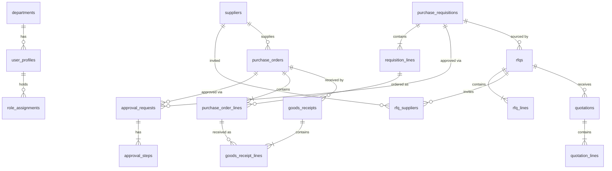

# Database schema (v1 design)

PostgreSQL 18. This is the **design**. The source of truth after Phase 2 is the Drizzle schema in `src/modules/*/infrastructure/` and the reviewed SQL in `db/migrations/`. If they drift, the migrations win and this document gets updated in the same change.

## Conventions

- **Primary keys:** `id uuid DEFAULT uuidv7()` (time-ordered; PostgreSQL 18 built-in, confirmed in Phase 1). Exceptions: Better Auth tables (text ids), `audit_events` (`bigint` identity), and composite-key join tables.
- **User references** point to Better Auth's `"user".id` (`text`) and are named `*_user_id`.
- **Timestamps:** `timestamptz`, `created_at DEFAULT now()`, `updated_at` set by the application. Business dates (`needed_by`, `received_on`) are `date` in the org timezone.
- **Status columns** are `text` with a `CHECK (status IN (...))`, not PostgreSQL enums, so states can evolve with plain migrations.
- **Mutable aggregate roots** carry `version integer NOT NULL DEFAULT 1` (ADR 0008 C1).
- **Money** `numeric(20,4)`, **quantities** `numeric(18,3)`, **percentages** `numeric(7,4)` (ADR 0007).
- **No hard deletes** of business documents. Drafts are cancelled, not deleted. Only draft lines can be removed (and that is audited).
- **Text limits** are enforced in Zod and backed by `CHECK (char_length(x) <= n)` on key columns.
- **Roles:** `procureflow_owner` owns everything. `procureflow_app` gets `SELECT, INSERT, UPDATE` on business tables, **no `DELETE`** except on draft line tables and `idempotency_keys`, and `INSERT, SELECT` only on `audit_events`. Roles are created by bootstrap, not migrations. Each migration grants per table, explicitly (ADR 0013).

---

## Identity (implemented in Phases 3a and 3b)

**Better Auth tables** (`users`, `sessions`, `accounts`, `verifications`, `rate_limits`) were generated by the Better Auth 1.7.7 CLI, then reviewed. They live in `src/modules/identity/infrastructure/auth-schema.ts`, with migrations `0003` and `0004`.
- Ids are `uuid DEFAULT gen_random_uuid()` (`generateId: uuid`), so every `*_user_id` below is `uuid`, not `text`.
- Timestamps are `timestamptz`.
- `users.email` is unique and lowercase (CHECK), and `users.name` (1 to 120 chars) is the display name. There is no separate `display_name`.
- `accounts.password` holds the scrypt hash. Sessions and accounts reference users with `ON DELETE CASCADE` as generated, but the runtime role has **no DELETE on users**, so that never fires through the app.

### `user_profiles`

| Column | Type | Constraints |
| --- | --- | --- |
| user_id | uuid | PK, FK → `users.id` (RESTRICT) |
| department_id | uuid | FK → departments, NULL allowed (e.g. auditor) |
| status | text | `CHECK IN ('active','deactivated')`, default `active` |
| deactivated_at / deactivated_by_user_id | timestamptz / uuid | set exactly when status is `deactivated` (CHECK). `CHECK (deactivated_by_user_id <> user_id)`: nobody deactivates themselves (SOD-05 backstop, migration 0005). |
| created_at, updated_at, version | | `version` is bumped by every profile or status change (ADR 0008 C1). |

### `role_assignments`

| Column | Type | Constraints |
| --- | --- | --- |
| id | uuid | PK, `uuidv7()` |
| user_id | uuid | FK → users, NOT NULL |
| role | text | `CHECK IN ('admin','requester','approver','procurement','receiver','finance','auditor')` (`buyer` renamed `procurement`, ADR 0014) |
| department_id | uuid | NULL means org-wide. `CHECK`: only `requester` and `approver` may be department-scoped. |
| granted_by, granted_at | text, timestamptz | a user id, or `system:bootstrap` / `system:seed`. `CHECK (granted_by <> user_id::text)` is the SOD-05 backstop. |
| revoked_by, revoked_at, revoke_reason | text, timestamptz, text | `revoked_at` and `revoked_by` both NULL or both set. Self-revocation is blocked by CHECK. `revoke_reason` ≤ 500 chars. |

Index `role_assignments_active_unique`: `UNIQUE (user_id, role, coalesce(department_id, nil-uuid)) WHERE revoked_at IS NULL`. Revocation is an update, never a delete, so assignment history is kept.

Trigger `role_assignments_revocation_only` (migration 0005, `BEFORE UPDATE`): the only allowed change is a one-time revocation (`revoked_at`, `revoked_by`, `revoke_reason` on a row not yet revoked). Changing `user_id`, `role`, `department_id`, or `granted_*`, or touching a revoked row, raises SQLSTATE `PFR01`, for every role including the owner.

**Runtime grants (migration 0004):** SELECT/INSERT/UPDATE on `users`, `accounts`, `departments`, `user_profiles`, `role_assignments`. DELETE as well only on `sessions`, `verifications`, `rate_limits`. Deactivation uses the DELETE grants to revoke the user's sessions and unused setup links (`verifications` rows `reset-password:*` whose value is the user id) in the same transaction.

**Admin-set lock:** commands that change users or roles take `pg_advisory_xact_lock(0x50460001)` first (ADR 0008 C9). It is not a table, but it is part of how the identity data stays consistent.

## Organization

### `departments` (implemented in Phase 3a)
`id uuid DEFAULT uuidv7()`, `code text UNIQUE CHECK (code ~ '^[A-Z0-9-]{2,16}$')`, `name` (1 to 120 chars), `is_active boolean DEFAULT true`, timestamps, `version`.

### `org_settings` (single row)

*Phase 5a implements `id`, `org_name`, `timezone` (IANA, checked against ICU), `currency_code` (ISO 4217, checked against ICU), `currency_scale`, `updated_at`, `updated_by_user_id`, `version`, plus `currency_locked_at`.* The migration (0009) inserts the row with neutral defaults (`My organization`, `UTC`, `USD`, 2). The first requisition sets `currency_locked_at`; from then on a trigger (`org_settings_currency_lock`, SQLSTATE `PFO01`) refuses any change to the currency, its scale, or the lock itself, for every role. The app role has SELECT and UPDATE only. The other columns below arrive with the phases whose behavior they control (maintainer decision, 2026-10-22): `rfq_required_above` and `min_quotes` in Phase 6 (implemented in 6b, migration 0014: no threshold and a minimum of 3 for existing installations; CHECKs `rfq_required_above >= 0` and `min_quotes BETWEEN 1 AND 10`); `po_approval_threshold` and `po_price_tolerance_pct` in Phase 7; `over_receipt_tolerance_pct` in Phase 8.

| Column | Type | Notes |
| --- | --- | --- |
| id | smallint | PK, `CHECK (id = 1)` |
| org_name | text | |
| timezone | text | IANA name, validated in the app (e.g. `UTC`, `America/New_York`) |
| currency_code | char(3) | ISO 4217 |
| currency_scale | smallint | `CHECK BETWEEN 0 AND 4` |
| rfq_required_above | numeric(20,4) | NULL means RFQs are never required |
| min_quotes | smallint | `CHECK BETWEEN 1 AND 10`, default 3 |
| po_approval_threshold | numeric(20,4) | NULL means every PO needs approval |
| po_price_tolerance_pct | numeric(7,4) | default 0 |
| over_receipt_tolerance_pct | numeric(7,4) | default 0 |
| updated_at, updated_by_user_id, version | | |

### `approval_policies`, `approval_policy_rules`, `approval_policy_steps`

Policies are **immutable once created**. "Editing" means creating a new policy and activating it, and the old one gets `superseded_at`.

- `approval_policies`: `id`, `document_type CHECK IN ('requisition','purchase_order')`, `name`, `is_active boolean`, `created_by_user_id`, `created_at`, `superseded_at`. Index: `UNIQUE (document_type) WHERE is_active`.
- `approval_policy_rules`: `id`, `policy_id FK`, `department_id` (NULL means any department), `min_amount numeric(20,4) NOT NULL DEFAULT 0`, `max_amount numeric(20,4)` (exclusive, NULL means unbounded), `CHECK (max_amount IS NULL OR max_amount > min_amount)`. When a policy is saved, the application rejects overlapping bands for the same department, and requires full coverage from 0 upward for the "any department" rules.
- `approval_policy_steps`: `rule_id FK`, `step_no smallint CHECK >= 1`, `required_role CHECK IN ('approver','finance')`, `scope_mode CHECK IN ('document_department','organization')`, `PK (rule_id, step_no)`.

Rule resolution: a department-specific rule beats an "any department" rule, then the amount band `[min, max)` is matched against the document total.

**Implemented in Phase 5a** (migrations 0008, 0009) with these additions: `approval_policies.version_no` (unique per document type, 1, 2, …), `CHECK (is_active = (superseded_at IS NULL))`; `approval_policy_rules.rule_no` (display order, 1–50); `approval_policy_steps.step_no` 1–5 and `CHECK (required_role <> 'finance' OR scope_mode = 'organization')`. Immutability is enforced by triggers (SQLSTATE `PFP01`, for every role): a policy can only be superseded, once; rules and steps can be inserted only in the transaction that created their policy (its `created_at` equals `now()`), and never updated or deleted. The app role has SELECT and INSERT on rules and steps, and UPDATE only on `approval_policies` (for superseding).

## Requisitions

### `purchase_requisitions`

| Column | Type | Constraints |
| --- | --- | --- |
| id | uuid | PK |
| number | text | UNIQUE, `PR-YYYY-NNNNNN` |
| requester_user_id | text | NOT NULL |
| department_id | uuid | NOT NULL, copied from the requester's profile at create |
| title | text | 1 to 200 chars |
| justification | text | ≤ 2000 chars |
| needed_by | date | |
| currency_code | char(3) | |
| estimated_total | numeric(20,4) | `CHECK >= 0`, server-computed |
| status | text | `CHECK IN ('draft','pending_approval','returned','approved','rejected','cancelled','closed')` |
| current_approval_request_id | uuid | FK, NULL allowed |
| submitted_at, approved_at | timestamptz | |
| cancelled_at, cancelled_by_user_id, cancel_reason | | |
| closed_at, closed_by_user_id, close_reason | | |
| created_at, updated_at, version | | |

Indexes: `(requester_user_id, status)`, `(department_id, status)`, `(status, submitted_at)`.

**Implemented in Phase 5a** (migrations 0008, 0009); the approval columns (`current_approval_request_id`, `submitted_at`, `approved_at`), the close columns, and the `(status, submitted_at)` index were added in Phase 5b (migration 0010), with CHECKs that tie them to the status: an approval round and a submission time exist together, and on every status except `draft` and `cancelled`; `approved` and `closed` have `approved_at`; `closed` has all three close fields; `close_reason` 1 to 500 characters. User and department references are `uuid` foreign keys. `currency_scale smallint` is stored next to `currency_code` (the scale used for its totals). CHECKs: number `^PR-[0-9]{4}-[0-9]{6}$`, text lengths, total ≥ 0, cancel fields set exactly when `cancelled`, reason ≤ 500. Trigger `purchase_requisitions_fixed_columns` (`PFQ01`): number, requester, department, currency, and creation time never change. The app role has SELECT, INSERT, UPDATE; no DELETE.

### `requisition_lines`

| Column | Type | Constraints |
| --- | --- | --- |
| id | uuid | PK |
| requisition_id | uuid | FK, NOT NULL |
| line_no | smallint | `UNIQUE (requisition_id, line_no)` |
| description | text | 1 to 500 chars |
| quantity | numeric(18,3) | `CHECK > 0` |
| uom | text | 1 to 16 chars |
| estimated_unit_price | numeric(20,4) | `CHECK >= 0` |
| line_total | numeric(20,4) | server-computed |
| ordered_qty | numeric(18,3) | `DEFAULT 0`, `CHECK (ordered_qty >= 0 AND ordered_qty <= quantity)` (backstop for no over-ordering) |

Implemented in Phase 5a. Trigger `requisition_lines_editable_only_in_draft` (`PFQ01`, threat T-02): lines can be inserted, changed, or deleted only while the requisition is `draft` or `returned`; afterwards the only allowed update changes nothing but `ordered_qty` (purchase orders, Phase 7). The app role has DELETE on this table only because draft lines are replaced on edit.

## Approvals

### `approval_requests`

| Column | Type | Constraints |
| --- | --- | --- |
| id | uuid | PK |
| document_type | text | `CHECK IN ('requisition','purchase_order')` |
| document_id | uuid | |
| round | smallint | `UNIQUE (document_type, document_id, round)` |
| policy_id | uuid | FK |
| amount_snapshot | numeric(20,4) | |
| department_id | uuid | snapshot |
| submitted_by_user_id | text | NOT NULL (used by SOD-01) |
| awarded_by_user_id | text | NULL; for POs from an award (used by SOD-06) |
| status | text | `CHECK IN ('pending','approved','rejected','returned','cancelled')` |
| created_at, completed_at, version | | |

Index: `UNIQUE (document_type, document_id) WHERE status = 'pending'` (AP-I1).

### `approval_steps`

| Column | Type | Constraints |
| --- | --- | --- |
| id | uuid | PK |
| approval_request_id | uuid | FK |
| step_no | smallint | `UNIQUE (approval_request_id, step_no)` |
| required_role | text | |
| scope_department_id | uuid | NULL means org-wide |
| status | text | `CHECK IN ('waiting','pending','approved','rejected','returned','cancelled')` |
| decided_by_user_id, decided_at | text, timestamptz | `CHECK ((status IN ('approved','rejected','returned')) = (decided_by_user_id IS NOT NULL))` |
| comment | text | ≤ 2000. Required for rejected and returned (CHECK). |

Index: `UNIQUE (approval_request_id, decided_by_user_id)` (SOD-02; NULLs are distinct, so undecided steps don't collide).
Trigger `approval_steps_no_self_approval` (`BEFORE UPDATE`): raises if `NEW.decided_by_user_id` equals the parent request's `submitted_by_user_id` or `awarded_by_user_id` (SOD-01, SOD-06, defense in depth).

**Implemented in Phase 5b** (migrations 0010 generated, 0011 hand-written), with these additions:
- `approval_requests` also freezes what was submitted: `document_number`, `document_title`, `currency_code`, `currency_scale`, and `policy_version_no`. User and department references are `uuid` foreign keys; `document_id` is not a foreign key (it points at a requisition or, later, a purchase order). CHECKs: `amount_snapshot > 0`, `completed_at` set exactly when the status is not `pending`, text lengths.
- `approval_steps.activated_at`: when the step became pending (set for every step that was ever pending). `step_no` 1 to 5; `required_role` `finance` only with a NULL scope. Partial index on pending steps by role and scope, for the inbox.
- Triggers (SQLSTATE `PFD01`, for every role including the owner): `approval_requests_guard`: the snapshot columns never change, a completed request never changes, nothing is deleted. `approval_steps_guard`: steps can be inserted only in the transaction that created their request, as `waiting` or `pending`; afterwards the route columns never change and the status only moves `waiting → pending | cancelled` or `pending → approved | rejected | returned | cancelled`; `activated_at` is set once; nothing is deleted. `approval_steps_no_self_approval` runs on INSERT and UPDATE.
- The app role has SELECT, INSERT, UPDATE on both tables, no DELETE.

## Suppliers

### `suppliers` (implemented in Phase 4, migrations 0006 and 0007)

| Column | Type | Constraints |
| --- | --- | --- |
| id | uuid | PK, `uuidv7()` |
| code | text | UNIQUE, `CHECK ~ '^SUP-[0-9]{6}$'`, from the gapless `SUP` sequence (`document_sequences`, year 0) |
| legal_name | text | 1 to 200 chars |
| normalized_name | text | duplicate key: NFKC, lowercase, punctuation and whitespace runs → one space. `UNIQUE WHERE status <> 'inactive'`. |
| tax_id | text | as typed, ≤ 40 chars, NULL allowed |
| tax_id_normalized | text | duplicate key: `^[A-Z0-9]{5,30}$`. NULL exactly when `tax_id` is. `UNIQUE WHERE tax_id_normalized IS NOT NULL` (also against inactive suppliers). |
| email, phone | text | validated formats (email lowercased), ≤ 254 / ≤ 30 chars |
| address_line1, address_line2, city, region, postal_code | text | ≤ 200 / 200 / 100 / 100 / 20 chars |
| country_code | text | `^[A-Z]{2}$`; the app accepts only the 249 ISO 3166-1 alpha-2 codes |
| status | text | `CHECK IN ('pending_review','active','blocked','inactive')` |
| created_by_user_id | uuid | NOT NULL, FK → users (SOD-03). Fixed for life (trigger `PFS01`). |
| identity_changed_by_user_id | uuid | FK → users; last user who changed `legal_name` / `tax_id` (SOD-03) |
| reviewed_by_user_id, reviewed_at, review_note | uuid, timestamptz, text | set together (CHECK); cleared when the identity changes, on unblock, and on reactivation; note ≤ 2000 |
| status_reason | text | reason for reject / block / deactivate, ≤ 2000 |
| created_at, updated_at, version | | `version` per ADR 0008 C1 |

CHECKs beyond the column rules:
- `suppliers_maker_checker`: `reviewed_by_user_id` is NULL, or differs from `created_by_user_id` and from `identity_changed_by_user_id` (SOD-03 backstop).
- `suppliers_active_is_reviewed`: an `active` supplier always has a reviewer (AB-04 backstop).

Trigger `suppliers_fixed_identity_columns` (`BEFORE UPDATE`) rejects changes to `id`, `code`, `created_by_user_id`, and `created_at` with SQLSTATE `PFS01`. Index `suppliers_status_code_idx (status, code)` serves the list. Grants: `procureflow_app` gets SELECT, INSERT, UPDATE; no DELETE.

**Bank and payment details are intentionally not stored in v1.** Payments are out of scope, and keeping them out removes the classic bank-detail-change fraud vector from this system.

## Sourcing

- `rfqs`: `id`, `number UNIQUE` (`RFQ-YYYY-NNNNNN`), `requisition_id FK`, `title`, `status CHECK IN ('draft','issued','closed','awarded','cancelled')`, `response_due_at timestamptz`, `created_by_user_id`, `issued_at`, `closed_at`, `awarded_quotation_id FK NULL`, `awarded_by_user_id`, `awarded_at`, `award_justification text`, `cancel_reason`, timestamps, `version`.
- `rfq_lines`: `id`, `rfq_id FK`, `line_no`, `requisition_line_id FK`, `description`, `quantity numeric(18,3) CHECK > 0`, `uom`, `UNIQUE (rfq_id, line_no)`, `UNIQUE (rfq_id, requisition_line_id)`.
- `rfq_suppliers`: `rfq_id`, `supplier_id`, `invited_by_user_id`, `invited_at`, `PK (rfq_id, supplier_id)`.
- `quotations`: `id`, `rfq_id`, `supplier_id`, `FK (rfq_id, supplier_id) → rfq_suppliers` (only invited suppliers), `supplier_reference`, `status CHECK IN ('draft','submitted','withdrawn','awarded','not_awarded')`, `currency_code`, `valid_until date`, `lead_time_days CHECK >= 0`, `total numeric(20,4)`, `recorded_by_user_id`, `submitted_at`, `withdraw_reason`, timestamps, `version`. Index: `UNIQUE (rfq_id, supplier_id) WHERE status <> 'withdrawn'`.
- `quotation_lines`: `id`, `quotation_id FK`, `rfq_line_id FK`, `quantity`, `unit_price CHECK >= 0`, `line_total`, `UNIQUE (quotation_id, rfq_line_id)`.

**Implemented in Phase 6a** (migrations 0012 generated, 0013 hand-written): `rfqs`, `rfq_lines`, `rfq_suppliers`, without the award columns, which arrive with quotations in Phase 6b. Additions: `issued_by_user_id`, `closed_by_user_id`, `cancelled_at`, `cancelled_by_user_id`; user and requisition references are `uuid` foreign keys. CHECKs: number `^RFQ-[0-9]{4}-[0-9]{6}$`, title 1 to 200, the issue, close, and cancel fields consistent with the status, `cancel_reason` 1 to 500; `rfq_lines` line number 1 to 200, quantity > 0, text lengths. Triggers (SQLSTATE `PFB01`, for every role): `rfqs_guard`: an RFQ is inserted only as a draft of an approved requisition, number, requisition, creator, and creation time never change, the status follows docs/state-machines.md §4, title and due time change only in a draft, issuing needs the requisition still approved, nothing is deleted. `rfq_lines_guard`: lines change only in drafts, belong to the RFQ's requisition, copy its description and unit, ask for no more than `quantity − ordered_qty`, and are on no other RFQ that is not cancelled. `rfq_suppliers_guard`: invitations change only in drafts, are never updated, and only active suppliers are invited. Grants: SELECT, INSERT, UPDATE on `rfqs`; SELECT, INSERT, UPDATE, DELETE on `rfq_lines` and SELECT, INSERT, DELETE on `rfq_suppliers` (drafts are replaced on edit; the triggers limit it to drafts).

**Implemented in Phase 6b** (migrations 0014 generated, 0015 hand-written): `quotations`, `quotation_lines`, and the award columns of `rfqs`.
- `rfqs`: `awarded_quotation_id` (FK to `quotations`), `awarded_by_user_id`, `awarded_at`, `award_justification` (1 to 2000), plus the rule as it stood at the award: `award_rfq_required_above`, `award_min_quotes`, `award_valid_quotes`, `award_below_min_quotes`, `award_not_lowest`. CHECKs: `rfqs_award_states` (an awarded RFQ has its award and rule; any other RFQ has none of it), `rfqs_award_justified` (either flag needs a justification), `rfqs_award_rule_range`.
- `quotations` as designed, plus `submitted_by_user_id`, `withdrawn_at`, `withdrawn_by_user_id`; `lead_time_days smallint` 0 to 365; `supplier_reference` 1 to 100; `withdraw_reason` 1 to 500; the submitted and withdrawn fields consistent with the status. The composite FK `quotations_invited_supplier_fk` and the partial unique index `quotations_one_live_per_supplier` are as designed.
- `quotation_lines` as designed (quantity > 0, price and total ≥ 0).
- Triggers (for every role): `rfqs_guard` (`PFB01`) now also refuses closing while a draft quotation exists, and an award unless the requisition is approved, the awarded quotation is a submitted one of this RFQ from an active supplier, the valid count is at most the submitted count, and the "fewer than the minimum" flag matches the stored threshold, minimum, valid count, and the requisition's estimated total. `quotations_guard` (`PFB02`): a quotation is inserted only as a draft of an issued RFQ, from an active supplier, in the requisition's currency; RFQ, supplier, currency, recorder, and creation time never change; the status follows docs/state-machines.md §4; the terms (reference, validity, lead time, total) change only in a draft, the submission never changes once made; drafts change and are submitted only while the RFQ is issued, and a submission needs the supplier active; a draft is withdrawn only from an issued RFQ, a submitted one only from an issued or closed RFQ; awarded and not awarded follow the RFQ's award; nothing is deleted. `quotation_lines_guard` (`PFB02`): lines change only in drafts of an issued RFQ, price a line of the quotation's own RFQ, for that line's quantity, with `line_total = round(quantity × unit_price, currency scale)`. Deferred constraint triggers `quotations_totals` and `quotation_lines_totals` (`PFB02`, at commit): a quotation prices every RFQ line exactly once and its total is the sum of its line totals. Expiry and "lowest valid" depend on the application clock and the org time zone, so only the application checks them.
- Grants: SELECT, INSERT, UPDATE on `quotations`; SELECT, INSERT, UPDATE, DELETE on `quotation_lines` (draft lines are replaced on edit; the trigger limits it to drafts).

## Purchasing

### `purchase_orders`

| Column | Type | Constraints |
| --- | --- | --- |
| id | uuid | PK |
| number | text | UNIQUE, `PO-YYYY-NNNNNN` |
| supplier_id | uuid | FK, NOT NULL |
| quotation_id | uuid | FK, NULL allowed |
| status | text | `CHECK IN ('draft','pending_approval','approved','issued','partially_received','received','closed','rejected','cancelled')` |
| currency_code | char(3) | |
| subtotal, tax_total, total | numeric(20,4) | server-computed, `CHECK >= 0` |
| payment_terms, delivery_address | text | |
| expected_delivery_date | date | |
| approval_reasons | text[] | e.g. `{AMOUNT_THRESHOLD, PRICE_VARIANCE}` computed at submit |
| current_approval_request_id | uuid | |
| created_by_user_id | text | NOT NULL (SOD-01, SOD-04) |
| submitted_at, approved_at, issued_at, issued_by_user_id | | |
| closed_at, closed_by_user_id, close_reason | | |
| cancelled_at, cancelled_by_user_id, cancel_reason | | |
| created_at, updated_at, version | | |

### `purchase_order_lines`

| Column | Type | Constraints |
| --- | --- | --- |
| id | uuid | PK |
| purchase_order_id | uuid | FK |
| line_no | smallint | `UNIQUE (purchase_order_id, line_no)` |
| requisition_line_id | uuid | FK, NOT NULL. Every PO line traces to an approved need. |
| quotation_line_id | uuid | FK, NULL allowed |
| description, uom | text | |
| quantity | numeric(18,3) | `CHECK > 0` |
| unit_price | numeric(20,4) | `CHECK >= 0` |
| tax_rate_pct | numeric(7,4) | `CHECK BETWEEN 0 AND 100` |
| line_subtotal, line_tax, line_total | numeric(20,4) | server-computed |
| received_qty | numeric(18,3) | `DEFAULT 0` |
| max_receivable_qty | numeric(18,3) | NULL until issued |

Constraints (over-receipt backstop, ADR 0008 C3):
`CHECK (received_qty >= 0)`,
`CHECK (max_receivable_qty IS NULL OR max_receivable_qty >= quantity)`,
`CHECK (received_qty = 0 OR (max_receivable_qty IS NOT NULL AND received_qty <= max_receivable_qty))`.

## Receiving

- `goods_receipts`: `id`, `number UNIQUE` (`GR-YYYY-NNNNNN`), `purchase_order_id FK`, `kind CHECK IN ('receipt','reversal')`, `reverses_goods_receipt_id FK UNIQUE NULL`, `CHECK ((kind = 'reversal') = (reverses_goods_receipt_id IS NOT NULL))`, `status CHECK IN ('draft','posted','cancelled')`, `received_on date`, `delivery_note_ref`, `notes`, `reason` (required for reversals), `created_by_user_id`, `posted_by_user_id`, `posted_at`, `cancel_reason`, timestamps, `version`.
- `goods_receipt_lines`: `id`, `goods_receipt_id FK`, `purchase_order_line_id FK`, `quantity numeric(18,3) CHECK > 0`, `note`, `UNIQUE (goods_receipt_id, purchase_order_line_id)`.

## Infrastructure

### `document_sequences`
`doc_type text`, `year smallint` (0 for non-yearly, e.g. suppliers), `last_value integer NOT NULL DEFAULT 0`, `PK (doc_type, year)`. Allocated with `UPDATE ... RETURNING` in the caller's transaction (ADR 0008 C5). Rows are created with `INSERT ... ON CONFLICT DO NOTHING` on first use.

### `idempotency_keys` (implemented in Phase 5a)
`user_id uuid` (not a foreign key: `src/shared` must not depend on the identity module), `key text CHECK (key ~ '^[A-Za-z0-9_-]{8,100}$')`, `operation text`, `request_hash text` (sha256 of the canonical input, `^[0-9a-f]{64}$`), `response jsonb`, `created_at`, `PK (user_id, key)`. **Keys do not expire yet**; a purge job is a Phase 10 item. The app role has SELECT, INSERT, UPDATE, DELETE.

### `audit_events` (ADR 0009)

| Column | Type | Constraints |
| --- | --- | --- |
| id | bigint | `GENERATED ALWAYS AS IDENTITY` PK |
| occurred_at | timestamptz | `NOT NULL DEFAULT now()` |
| actor_user_id | text | NULL means system |
| actor_roles | text[] | `NOT NULL DEFAULT '{}'` (snapshot) |
| action | text | NOT NULL, e.g. `requisition.submitted` |
| entity_type | text | NOT NULL |
| entity_id | text | NOT NULL |
| changes | jsonb | `NOT NULL DEFAULT '{}'`; `{field: [before, after]}`, redacted |
| reason | text | NULL allowed |
| request_id | uuid | NULL allowed |
| ip | inet | NULL allowed |
| user_agent | text | truncated to 512 |

Indexes: `(entity_type, entity_id, occurred_at)`, `(actor_user_id, occurred_at)`, `(occurred_at)`, `(action, occurred_at)`.
Triggers: `audit_events_no_update_delete` (BEFORE UPDATE OR DELETE, FOR EACH ROW) and `audit_events_no_truncate` (BEFORE TRUNCATE, FOR EACH STATEMENT), both calling `audit_events_reject_modification()`, which raises SQLSTATE **`PFA01`**.
Grants: `procureflow_app` gets `INSERT, SELECT` on the table and nothing else. Identity inserts need no sequence grant (verified in Phase 2, ADR 0013).
Additional CHECKs (implemented in Phase 2): `action` format, `entity_type` format, length limits on `entity_id` (1–128), `actor_user_id` (≤128), `reason` (≤2000), `user_agent` (≤512), and `jsonb_typeof(changes) = 'object'`.

**Implemented in Phase 2:** `document_sequences` and `audit_events` (migrations `0001`, `0002`). Every other table in this document is still a design.

## Entity relationships (summary)

