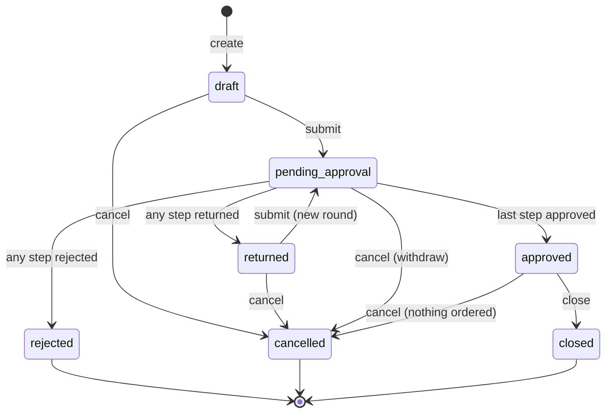
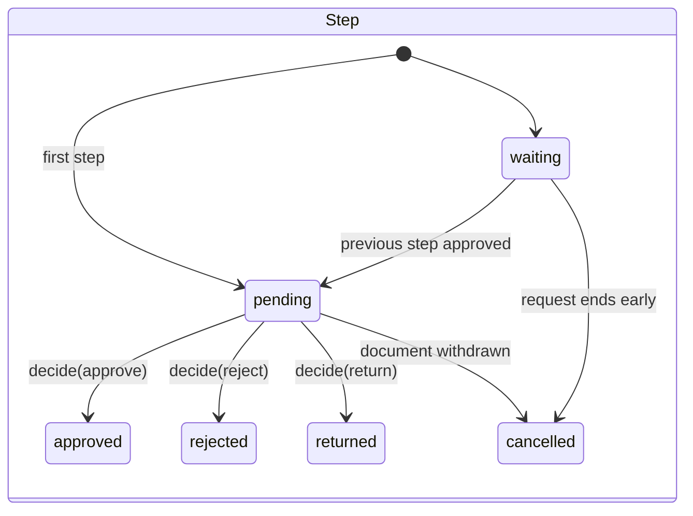
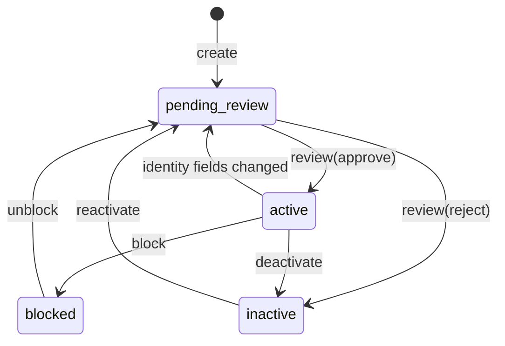
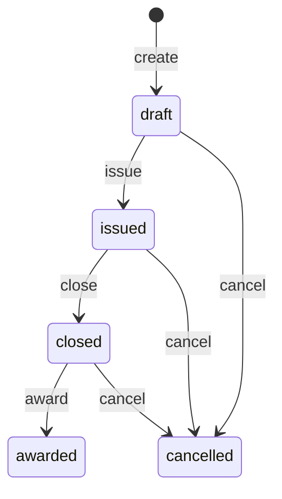
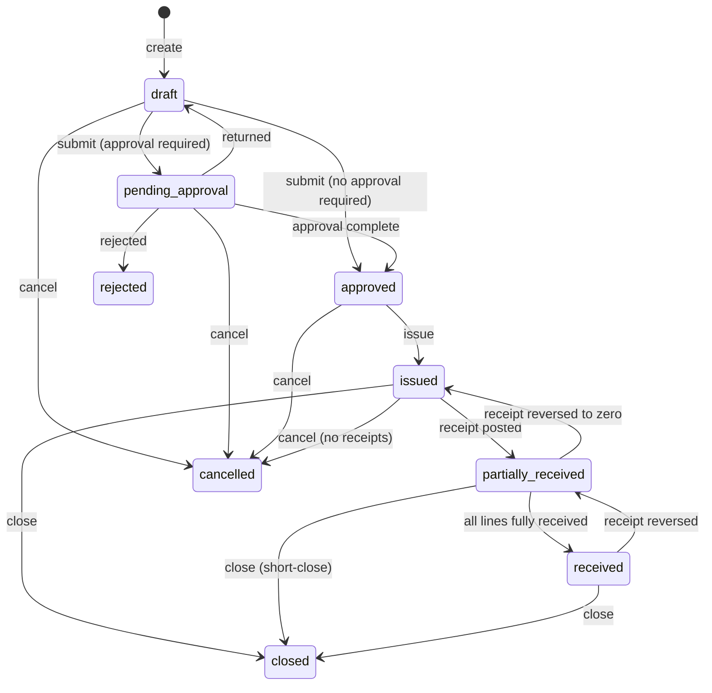
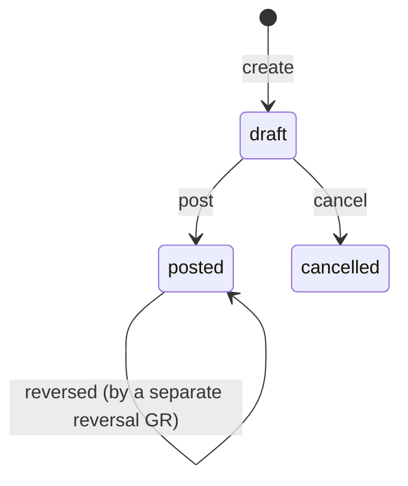
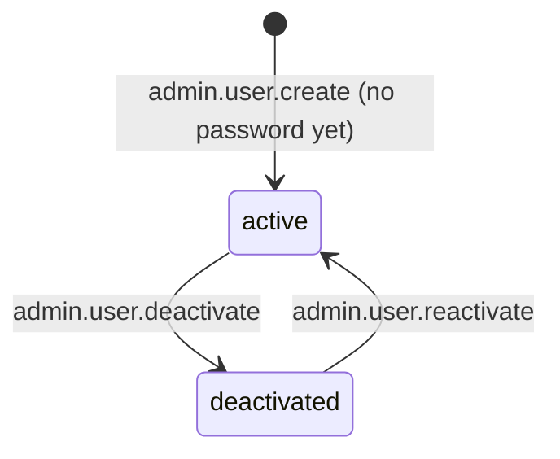

# State machines

Every transition below is validated **on the server**, inside the command's transaction, **after** the document row is locked (ADR 0008). Any transition not listed is rejected with `INVALID_TRANSITION`. Each machine is implemented once in `modules/<m>/domain/` as a pure transition table and tested exhaustively: every (state, command) pair is either listed here or must be rejected.

Notation: **Actor** is the permission plus any resource rule. **Guards** must all hold. **Effects** happen atomically with the transition, and every transition writes an audit event named after its command.

---

## 1. Purchase requisition (PR) (table implemented in Phase 5a; PR-T01, T02, T07 wired; the rest in 5b)

| ID | From → To | Command | Actor | Guards | Effects |
| --- | --- | --- | --- | --- | --- |
| PR-T01 | ∅ → draft | `requisition.create` | `requisition.create` | Actor profile active with a department. 1 to 200 lines. | Number allocated (`PR-YYYY-NNNNNN`). Line and document totals computed server-side. `currency_code` = org currency. |
| PR-T02 | draft → draft, returned → returned | `requisition.update` | owner (requester) | `expectedVersion` matches | Replace header and lines, recompute totals, `version+1`. Audit records changed fields. |
| PR-T03 | draft / returned → pending_approval | `requisition.submit` | owner | ≥1 line. `estimated_total` > 0. `needed_by` ≥ today (org timezone). Active approval policy resolves **≥1 step** (otherwise `BUSINESS_RULE: NO_APPROVAL_ROUTE`; a PR is **never auto-approved**). | New `approval_request` (round = previous + 1) with a step snapshot. Step 1 is `pending`, the rest `waiting`. Lines become read-only. |
| PR-T04 | pending_approval → approved | (system, from AP-T02) | | Final step approved | `approved_at` set |
| PR-T05 | pending_approval → rejected | (system, from AP-T03) | | | Terminal |
| PR-T06 | pending_approval → returned | (system, from AP-T04) | | | Editable again by the owner. The approver's comment is shown. |
| PR-T07 | draft / returned → cancelled | `requisition.cancel` | owner | | `cancel_reason` optional |
| PR-T08 | pending_approval → cancelled | `requisition.cancel` | owner | reason required | Live approval request and its open steps become `cancelled` |
| PR-T09 | approved → cancelled | `requisition.cancel` | owner or `po.create` holder | reason required. **Every line has `ordered_qty = 0`.** | Terminal |
| PR-T10 | approved → closed | `requisition.close` | `po.create` holder | reason required | Remaining unordered quantity can no longer be ordered. Terminal. There is no automatic close in v1; the UI shows ordering progress instead. |

Invariant PR-I1: `0 ≤ ordered_qty ≤ quantity` per line (DB CHECK). Ordered quantity changes only through PO commands.

Implementation (Phase 5a): the pure table is `modules/requisitions/domain/requisition.ts`, all 49 (status, command) pairs tested in `tests/unit/requisition-domain.test.ts`. `requisition.create`, `.update`, and `.cancel` (draft and returned) are commands now; `.submit`, the approval-driven transitions, PR-T08, PR-T09, and PR-T10 arrive with Phase 5b. The year in `PR-YYYY-NNNNNN` is the current year in the org time zone. A trigger keeps lines read-only outside `draft` and `returned` (T-02).

---

## 2. Approval request and steps (shared by PR and PO)

One **approval request** per submission round. Its **steps** are a snapshot taken at submit time from the active approval policy, matched by document type, department, and amount. Later policy changes never affect an in-flight request.

| ID | Transition | Command | Actor | Guards | Effects |
| --- | --- | --- | --- | --- | --- |
| AP-T01 | create request + steps | (inside PR-T03 / PO-T03) | | Policy resolves ≥1 step | Request `pending`, step 1 `pending` |
| AP-T02 | step pending → approved | `approval.decide` `{decision: 'approve'}` | `approval.decide` and holds the step's `required_role` within the step's scope | Request `pending`, step `pending`, `expectedVersion` matches. **SOD-01**: actor ≠ request `submitted_by`. **SOD-02**: actor has not decided another step in this request. **SOD-06** for POs. | Next step → `pending`. If it was the last step: request → `approved`, document → `approved`. |
| AP-T03 | step pending → rejected | `approval.decide` `{decision: 'reject', comment}` | same | same + comment 1 to 2000 chars | Remaining steps → `cancelled`. Request → `rejected`. Document → PR `rejected` / PO `rejected`. |
| AP-T04 | step pending → returned | `approval.decide` `{decision: 'return', comment}` | same | same + comment | Remaining steps → `cancelled`. Request → `returned`. Document → PR `returned` / PO `draft`. |
| AP-T05 | request → cancelled | (inside PR-T08 / PO-T08) | | | Open steps → `cancelled` |

Eligibility of a step: a user is eligible if they hold an **active** assignment of `required_role` whose scope is the document's department or org-wide (`scope_mode = document_department`), or an org-wide assignment (`scope_mode = organization`), and SoD does not exclude them. If no user is eligible, the step stays pending and shows up in the approval-aging report. Approvals are never skipped automatically.

Invariants: AP-I1 at most one `pending` request per document (partial unique index). AP-I2 at most one decision per step (decided fields set once, from `pending` only). AP-I3 SOD-01 is also enforced by a DB trigger. AP-I4 SOD-02 is also enforced by a unique index on `(approval_request_id, decided_by_user_id)`.

---

## 3. Supplier (implemented in Phase 4)

| ID | Transition | Command | Actor | Guards | Effects |
| --- | --- | --- | --- | --- | --- |
| SUP-T01 | ∅ → pending_review | `supplier.create` | `supplier.manage` | `normalized_name` unique among non-inactive suppliers. `tax_id` unique when present. | Code `SUP-NNNNNN` |
| SUP-T02 | edit contact fields (any non-terminal state) | `supplier.update` | `supplier.manage` | version | State unchanged |
| SUP-T03 | active → pending_review | `supplier.update` that changes `legal_name` or `tax_id` | `supplier.manage` | version | `identity_changed_by` = actor. Re-review required. |
| SUP-T04 | pending_review → active | `supplier.review` `{decision:'approve'}` | `supplier.review` | **SOD-03**: actor ≠ `created_by` and ≠ `identity_changed_by` | `reviewed_by`, `reviewed_at` |
| SUP-T05 | pending_review → inactive | `supplier.review` `{decision:'reject', note}` | `supplier.review` | SOD-03 | |
| SUP-T06 | active → blocked | `supplier.block` | `supplier.block` (procurement or finance; ADR 0006 amendment) | reason | |
| SUP-T07 | blocked → pending_review | `supplier.unblock` | `supplier.review` | reason | Needs a fresh review (SUP-T04) |
| SUP-T08 | active → inactive | `supplier.deactivate` | `supplier.manage` | reason | |
| SUP-T09 | inactive → pending_review | `supplier.reactivate` | `supplier.manage` | uniqueness re-checked | |

Implementation notes (Phase 4), recorded where the table above left room:
- The pure table is `modules/suppliers/domain/supplier.ts`; all 32 (status, command) pairs are tested in `tests/unit/supplier-domain.test.ts`.
- "Non-terminal" in SUP-T02 means `pending_review`, `active`, and `blocked`. An inactive supplier cannot be edited; reactivate it first.
- An identity change (any edit of `legal_name` or `tax_id` **as typed**, even case only) on `pending_review` or `blocked` keeps the status, but sets `identity_changed_by` and clears the review, so the next approval needs someone else (SOD-03).
- Reject (SUP-T05) needs a note, which becomes `status_reason`. Block, unblock, and deactivate need a reason.
- Unblock (SUP-T07) and reactivate (SUP-T09) clear the old review. A CHECK guarantees that an active supplier always has a reviewer, and that the reviewer is neither the creator nor the last identity changer.
- Duplicate keys (maintainer decision 2026-10-22): names compare after Unicode normalization, lowercasing, and turning every run of punctuation or whitespace into one space (`PT. Maju-Jaya` = `pt maju jaya`); legal suffixes still count. Tax IDs compare as letters and digits only. Names must be unique among non-inactive suppliers, tax IDs among all suppliers.

Rule SUP-R1: only `active` suppliers can be invited to RFQs, quoted, put on new POs, or have a PO **issued** to them. Receipts against already-issued POs are still allowed whatever the supplier's status, because the goods physically arrived.

---

## 4. Request for quotation (RFQ) and quotation

| ID | Transition | Command | Actor | Guards | Effects |
| --- | --- | --- | --- | --- | --- |
| RFQ-T01 | ∅ → draft | `rfq.create` | `rfq.manage` | PR `approved`. Selected lines have remaining qty (`quantity − ordered_qty`) > 0. RFQ line qty ≤ remaining. | Number `RFQ-YYYY-NNNNNN` |
| RFQ-T02 | draft → draft | `rfq.update` (lines, due date, invited suppliers) | `rfq.manage` | invited suppliers `active` | |
| RFQ-T03 | draft → issued | `rfq.issue` | `rfq.manage` | ≥1 invited supplier. `response_due_at` in the future. | v1 sends nothing to suppliers; the buyer contacts them out of band. |
| RFQ-T04 | issued → closed | `rfq.close` | `rfq.manage` | | No more quotations |
| RFQ-T05 | closed → awarded | `quotation.award` | `quotation.award` | Chosen quotation `submitted`, `valid_until` ≥ today, supplier `active`. If PR `estimated_total` ≥ `rfq_required_above` and fewer than `min_quotes` quotations were submitted, a justification is required. If the chosen quotation is not the lowest total among valid submitted quotations, a justification is required. | Chosen → `awarded`, other submitted → `not_awarded`. `awarded_by` recorded (for SOD-06). |
| RFQ-T06 | draft / issued / closed → cancelled | `rfq.cancel` | `rfq.manage` | reason | Open quotations stay as recorded |

Quotation (recorded by the buyer; suppliers have no login in v1):

| ID | Transition | Command | Guards |
| --- | --- | --- | --- |
| QUO-T01 | ∅ → draft | `quotation.record` | RFQ `issued`, supplier invited and `active`, no other non-withdrawn quotation from that supplier on this RFQ |
| QUO-T02 | draft → draft | `quotation.update` | Lines cover every RFQ line exactly once, quantity equals RFQ quantity. Totals computed server-side. |
| QUO-T03 | draft → submitted | `quotation.submit` | RFQ `issued`, `valid_until` ≥ today |
| QUO-T04 | submitted → withdrawn | `quotation.withdraw` | RFQ not `awarded`. Reason required. |
| QUO-T05 | submitted → awarded / not_awarded | (system, RFQ-T05) | |

---

## 5. Purchase order (PO)

| ID | Transition | Command | Actor | Guards | Effects |
| --- | --- | --- | --- | --- | --- |
| PO-T01 | ∅ → draft | `po.create` | `po.create` | Supplier `active`. Every line references a PR line whose PR is `approved`. **RFQ rule:** if the PR's `estimated_total` ≥ `rfq_required_above`, the PO must reference an `awarded` quotation for those lines (`BUSINESS_RULE: RFQ_REQUIRED`). | **Reserve quantity** per line with C2: `ordered_qty += qty` only if it stays ≤ `quantity`, otherwise `BUSINESS_RULE: OVER_ORDER`. Totals computed. Number `PO-YYYY-NNNNNN`. |
| PO-T02 | draft → draft | `po.update` (lines, terms, tax rates) | creator or `po.create` | version | Re-reserve the quantity deltas with C2 (release decreases, reserve increases). Recompute totals. |
| PO-T03 | draft → pending_approval / approved | `po.submit` | `po.create` | ≥1 line. Approval is **required** if any of: `total` ≥ `po_approval_threshold`; any line's `unit_price` exceeds its PR line `estimated_unit_price` by more than `po_price_tolerance_pct`; PO total exceeds the referenced PR lines' approved estimate by more than the tolerance. | If required: approval request (AP-T01) with policy `purchase_order`, reasons stored. Otherwise → `approved`, audited with reason `BELOW_THRESHOLD`. |
| PO-T04 | pending_approval → approved / draft / rejected | (system, AP-T02/03/04) | | | **Rejected is terminal and releases every line's reserved quantity.** |
| PO-T05 | approved → issued | `po.issue` | `po.create` | Supplier `active` | `max_receivable_qty = floor3(quantity × (1 + over_receipt_tolerance_pct/100))` snapshot per line. PO becomes immutable. |
| PO-T06 | issued ⇄ partially_received ⇄ received | (system, GR-T02 / GR-T04) | | | Status derived: all lines `received_qty ≥ quantity` → `received`; any > 0 → `partially_received`; otherwise `issued`. |
| PO-T07 | issued / partially_received / received → closed | `po.close` | `po.create` | reason required unless `received` | Release `max(0, quantity − received_qty)` back to each PR line's `ordered_qty`. No further receipts. |
| PO-T08 | draft / pending_approval / approved → cancelled | `po.cancel` | `po.create` | reason | Release all reserved quantity. Cancel the live approval request. |
| PO-T09 | issued → cancelled | `po.cancel` | `po.create` | reason. **No posted receipts** (every `received_qty = 0`). | Release all reserved quantity |

Invariants: PO-I1 for every PR line, `ordered_qty` = Σ `quantity` of its PO lines on POs in `draft`, `pending_approval`, `approved`, `issued`, `partially_received`, or `received`, plus Σ `min(quantity, received_qty)` of its PO lines on `closed` POs. Cancelled and rejected POs contribute nothing. A test helper checks this after every concurrency test. PO-I2 totals equal the recomputation from lines. PO-I3 an issued PO's lines are never modified except `received_qty`.

There are no change orders after issue in v1. To change an issued PO: cancel it (if nothing has been received) and create a new one.

---

## 6. Goods receipt (GR)

| ID | Transition | Command | Actor | Guards | Effects |
| --- | --- | --- | --- | --- | --- |
| GR-T01 | ∅ → draft | `receipt.create` | `receipt.create` | PO `issued` or `partially_received`. **SOD-04**: actor ≠ PO creator. Lines reference this PO's lines, qty > 0. `received_on` ≤ today and ≥ PO `issued_at` date. | Number `GR-YYYY-NNNNNN` |
| GR-T02 | draft → posted | `receipt.post` | `receipt.create`, SOD-04 | PO (locked) still `issued` / `partially_received`. For **each** line, C2: `received_qty += qty` only if it stays ≤ `max_receivable_qty`. **Any failure rolls back the whole receipt** with `BUSINESS_RULE: OVER_RECEIPT` naming the line(s). | PO status re-derived (PO-T06). Posted receipts are immutable. |
| GR-T03 | draft → cancelled | `receipt.cancel` | creator | | |
| GR-T04 | posted receipt → reversal GR (posted) | `receipt.reverse` | `receipt.create`, SOD-04 | Original `kind=receipt`, `posted`, not already reversed. PO not `closed` / `cancelled`. Reason required. | New GR `kind=reversal` with the same lines. C2: `received_qty −= qty` with `≥ 0`. PO status re-derived. |

Invariants: GR-I1 `po_lines.received_qty` = sum of posted receipt quantities − sum of posted reversal quantities for that line (test helper). GR-I2 `0 ≤ received_qty ≤ max_receivable_qty` (DB CHECK). GR-I3 a receipt is reversed at most once (unique `reverses_goods_receipt_id`).

---

## 7. User account (implemented in Phase 3b)

The stored status has two values, `active` and `deactivated` (`user_profiles.status`). "Pending setup" is not a status: it is an active user without a password (no credential account), shown as a badge. With two states the transitions are checked directly in the commands (`application/admin-users.ts`) rather than in a domain table. All four (state, command) pairs are tested in `tests/integration/admin.test.ts`.

| ID | Transition | Command | Actor | Guards | Effects |
| --- | --- | --- | --- | --- | --- |
| USR-T01 | ∅ → active | `admin.user.create` | `admin.users` (+ `admin.roles` for initial roles) | Email unique. Departments active. Scope rules. | Profile, roles, audit. Then a one-time setup link. |
| USR-T02 | active → deactivated | `admin.user.deactivate` | `admin.users`, **SOD-05** (not self) | version, reason, `LAST_ADMIN` under the admin-set lock | All sessions and unused setup links deleted in the same transaction. Sign-in refused from then on. |
| USR-T03 | deactivated → active | `admin.user.reactivate` | `admin.users`, SOD-05 | version | Signs in again with the existing password. Roles are as they were. |
| USR-T04 | active, no password → same (new link) | `admin.user.issueSetupLink` | `admin.users`, SOD-05 | no password set yet (`PASSWORD_ALREADY_SET`) | Earlier unused links deleted |

`deactivated` + `admin.user.deactivate` and `active` + `admin.user.reactivate` → `INVALID_TRANSITION`. `deactivated` + `admin.user.issueSetupLink` or `admin.role.grant` → `BUSINESS_RULE: USER_DEACTIVATED`.
