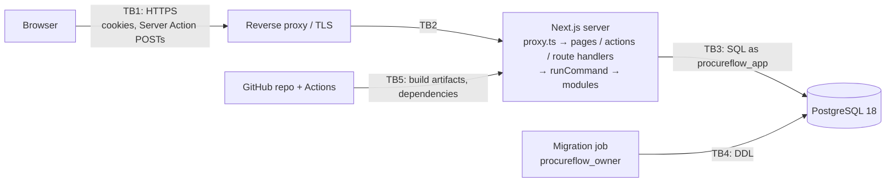

# Threat model (v1 design)

Method: STRIDE per trust boundary, plus procurement-specific abuse cases. This model is reviewed at the end of every phase. Any new endpoint, role, or data type requires an update here **before** it is merged.

## 1. Scope and assumptions

- A self-hosted Next.js 16 server (Node.js runtime) behind a TLS-terminating reverse proxy, with PostgreSQL 18 on a private network.
- Users are employees of one organization. There are no supplier logins in v1.
- The operator controls the host, database, and secrets. A malicious operator or DB superuser is **out of scope** (see section 7).
- Not stored in v1: bank details, payment data, attachments, government IDs. Personal data is limited to names, work emails, departments, IP and user agent in sessions and audit.

## 2. Assets

| ID | Asset | Why it matters |
| --- | --- | --- |
| A1 | Credentials and sessions | Account takeover means acting as an approver or buyer |
| A2 | Approval decisions | They authorize spending |
| A3 | Supplier master data | Fake or altered suppliers are a fraud vector |
| A4 | PO quantities and prices | Inflation and over-ordering |
| A5 | Receipt quantities | Over-receipt means paying for goods never delivered (in downstream systems) |
| A6 | Audit trail | Detection and accountability |
| A7 | Role assignments and settings | Privilege escalation, threshold manipulation |
| A8 | Secrets (`BETTER_AUTH_SECRET`, `DATABASE_URL`, `NEXT_SERVER_ACTIONS_ENCRYPTION_KEY`) | Total compromise |

## 3. Threat agents

| ID | Agent | Capability |
| --- | --- | --- |
| T1 | Anonymous internet attacker | Reaches the login page and any public endpoint |
| T2 | Authenticated low-privilege insider (requester, receiver) | Valid session. Can craft raw POSTs to Server Actions and edit hidden form fields. |
| T3 | Privileged insider (buyer, approver, finance) acting alone | Wants to bypass controls for personal gain |
| T4 | Two colluding insiders | Complementary roles |
| T5 | Malicious or compromised admin | Manages users and settings |
| T6 | Compromised dependency or CI | Code execution at build or run time |

## 4. Trust boundaries and data flow

## 5. STRIDE analysis

| ID | Boundary | Threat | Mitigation | Verified by |
| --- | --- | --- | --- | --- |
| S-01 | TB1 | Credential stuffing or brute force on login (T1) | Better Auth rate limiting (DB-backed). Generic error messages. Minimum password length 12 plus a common-password blocklist. | Phase 3: rate-limit integration test, E2E message test |
| S-02 | TB1 | Session theft through XSS | `HttpOnly` cookies. React escaping. `dangerouslySetInnerHTML` banned by lint. Nonce-based CSP. | Phase 3: header test. Lint rule. |
| S-03 | TB1 | Session fixation or replay after logout | Better Auth issues a new session on sign-in. Logout deletes the session row. Deactivation revokes all sessions. | Phase 3: tests US-ID-02 and US-ID-03 |
| S-04 | TB1 | Public self-registration creates accounts (T1) | Sign-up disabled. Users are created only by admins. | Phase 3: sign-up endpoint rejected |
| T-01 | TB1→TB2 | Tampered form fields: totals, status, department, `*_by` (T2) | Strict Zod schemas (`.strict()`) reject unknown fields. Server computes totals and derives department, currency, and actor. | Every phase: tamper tests per command |
| T-02 | TB2 | Editing a document after approval to change quantity or price (T3) | State machine allows edits only in draft/returned. Lines read-only after submit. Issued POs immutable. Version checks. | Phases 5 and 7: invalid-transition tests |
| T-03 | TB3 | SQL injection | Drizzle parameterized queries. `sql.raw` banned outside `db/` scripts. Sort and filter fields whitelisted. | Lint rule. Phase 5: injection-string tests on search filters. |
| T-04 | TB3 | Lost updates or races corrupting counters (T2/T3) | ADR 0008: row locks, versions, conditional updates, CHECK constraints | Concurrency suite CC-01 to CC-07 |
| T-05 | TB1 | CSRF on Server Actions or route handlers | Server Actions are POST-only with Next.js Origin/Host comparison. `SameSite=Lax` cookies. No state change on GET (lint and review rule). Route handlers mutating state also check Origin. | Phase 3: cross-origin POST test |
| T-06 | TB1 | CSV/formula injection in exports | Prefix cells starting with `= + - @`, TAB, or CR | Phase 9: unit test |
| R-01 | all | User denies performing an action | Append-only audit in the same transaction, DB clock, actor and role snapshot, request id | Phase 2: audit tests. Every command asserts its audit event. |
| R-02 | TB3 | Audit rows edited or deleted through a compromised app (T2–T5) | App role has only INSERT/SELECT. Triggers block UPDATE/DELETE/TRUNCATE for all roles. | Phase 2: privilege and trigger tests |
| I-01 | TB2 | IDOR: reading another user's PR or PO by id (T2) | Resource checks in every query. List queries scoped in SQL. Unauthorized reads return `NOT_FOUND`. | Phase 5 onward: cross-user read tests per entity |
| I-02 | TB2→TB1 | Over-exposed data in RSC payloads or action results | Data Access Layer returns DTOs only. `server-only` on DAL. Action results minimal. React taint API on user/session objects. | Lint check. Phase 3: test that DTO keys match an allowlist. |
| I-03 | TB2 | Error messages leaking SQL or stack traces | `INTERNAL` returns a generic message. Details only in server logs with request id. | Phase 2: runner test |
| I-04 | TB5 | Secrets committed to the repo | `.env*` gitignored. gitleaks in CI and local script. `.env.example` placeholders only. | Phase 1: gitleaks run in report |
| I-05 | logs | PII or secrets in logs | Structured logger with redaction allowlist. No request bodies logged. | Phase 2: logger unit test |
| D-01 | TB1 | Oversized payloads or line counts (T1/T2) | Max 200 lines per document. String length limits. Server Action body size limit configured. Pagination capped at 100. | Phase 5: validation tests |
| D-02 | TB3 | Long-held locks blocking others | `lock_timeout` 5 s, `statement_timeout` 15 s | CC-07 |
| D-03 | TB1 | Login flood filling audit table | Rate limiting before audit writes. Access-denied events go to logs, not the audit table. | Phase 3 |
| E-01 | TB2 | Calling a Server Action without the required role (T2) | `runCommand` permission check plus resource policy. The page-level check is not relied on. | Phase 3: permission matrix test (every command × every role × anonymous) |
| E-02 | TB2 | Admin escalates self or locks out other admins (T5) | SOD-05. `LAST_ADMIN`. Role definitions in code. All role changes audited. | Phase 3 tests |
| E-03 | TB2 | Lowering approval thresholds to dodge approval (T5) | Settings and policy changes audited. In-flight approvals use the snapshot. Never auto-approve when no route exists. Thresholds visible in reports. | Phase 5 tests. Phase 9 audit view. |
| E-04 | TB5 | Malicious dependency (T6) | Exact pins plus lockfile. `npm ci`. `npm audit` gate. Dependabot. Minimal dependency set. Install scripts reviewed for new dependencies. | Phase 1 onward: audit output in every report |

## 6. Procurement abuse cases

| ID | Abuse case | Control | Test |
| --- | --- | --- | --- |
| AB-01 | Requester approves own PR | SOD-01 (app + DB trigger) | Phase 5 |
| AB-02 | One approver clears every step | SOD-02 (app + unique index) | Phase 5 |
| AB-03 | Buyer creates a fake supplier and orders from it | SOD-03 maker-checker. Only active suppliers can be ordered from. | Phase 4 |
| AB-04 | Supplier identity swapped after review | Identity change sends supplier back to review | Phase 4 |
| AB-05 | Buyer inflates PO prices after PR approval | Price-variance tolerance triggers PO approval. SOD-01 and SOD-06 on PO approval. | Phase 7 |
| AB-06 | Buyer orders more than approved | `OVER_ORDER` (C2 + CHECK) | Phase 7, CC-03 |
| AB-07 | Buyer skips competitive sourcing | `RFQ_REQUIRED` above threshold. Justification for fewer than min quotes or non-lowest award. | Phases 6 and 7 |
| AB-08 | Buyer confirms receipt of goods never delivered | SOD-04 (PO creator ≠ receiver) | Phase 8 |
| AB-09 | Over-receipt to justify a larger invoice downstream | `OVER_RECEIPT` (C2 + CHECK) | Phase 8, CC-04 |
| AB-10 | Splitting a purchase to stay under thresholds | Not preventable by rule. Detected by the potential-split-purchases report. | Phase 9 |
| AB-11 | Colluding requester and approver (T4) | Not preventable by SoD. Detected by audit, aging, and spend reports. Residual risk accepted. | n/a |

## 7. Accepted risks and out of scope

- **DB superuser or schema owner** can alter data and drop triggers. Mitigations are operational: separate credentials, backups, and optional hash-chained audit export in Phase 10.
- **Collusion** between users with complementary roles (AB-11) is detectable, not preventable.
- **Compromised endpoint device** of a legitimate user: optional TOTP 2FA (Phase 10) reduces but doesn't remove this.
- **Availability under DDoS** is the reverse proxy and hosting provider's job, not the application's.

## 8. Security requirements checklist (verified in phases noted)

- [ ] (P3) Response headers: `Content-Security-Policy` (nonce, `frame-ancestors 'none'`), `Strict-Transport-Security` (production), `X-Content-Type-Options: nosniff`, `Referrer-Policy: strict-origin-when-cross-origin`, `Permissions-Policy` minimal.
- [ ] (P3) Cookies: `HttpOnly`, `Secure` in production, `SameSite=Lax`, host-only.
- [ ] (P1) Environment validated at startup with Zod. The app refuses to start with missing or weak secrets (length ≥ 32 bytes).
- [x] (P2) The app connects as `procureflow_app` (no DDL). Migrations run as `procureflow_owner`. Verified in Phase 2 by `tests/integration/audit.test.ts` (`current_user`, 42501 on DDL/UPDATE/DELETE/TRUNCATE/DISABLE TRIGGER). Deployment wiring is still Phase 10.
- [ ] (P3) `NEXT_SERVER_ACTIONS_ENCRYPTION_KEY` documented for multi-instance deployments.
- [ ] (P1) No source maps served in production unless explicitly enabled.
- [ ] (P10) Dependency audit clean at `high` or accepted with a written note.
